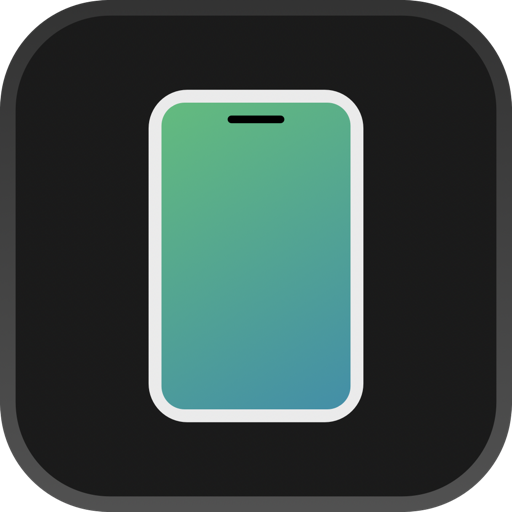

<div align="center">



# Android Mirroring

**Your Android phone, in a window on your Mac.**

Utilities &nbsp;·&nbsp; Free &nbsp;·&nbsp; Open source &nbsp;·&nbsp; For macOS

<sub>Android Mirroring is an independent project. It is not affiliated with or endorsed by Apple or Google.</sub>

</div>

<br>

| Platform | Price | Size | Category |
|:---:|:---:|:---:|:---:|
| Mac | Free | 1.8 MB | Utilities |

## What's New

**Version 0.1**

- First public version.
- **Sound.** Your phone's audio plays on your Mac, in stereo, and stays in step.
- **Copy and paste between the two.** ⌘V pastes your Mac's clipboard on the phone. ⌘C and ⌘X on the phone land on your Mac.
- **Scrolling that follows your fingers.** Trackpad scrolling is proportional now, not all-or-nothing.
- **Disconnect means disconnect.** The phone stays disconnected until you plug it back in or press Connect. A dropped cable still reconnects on its own.
- Quitting cleans up after itself on the Mac and on the phone.

## About

Plug in an Android phone and it appears on your Mac as a floating, phone-shaped window. Click to tap, drag to swipe, scroll to scroll, type on your Mac's keyboard. Unplug it and the window goes away.

There's nothing to install on the phone and no account to make. Under the hood it's a native Swift client for the [scrcpy](https://github.com/Genymobile/scrcpy) server: hardware H.264 decode, drawn straight to a Core Animation layer, with no cross-platform toolkit in between.

### Made for the Mac

- **Connects by itself.** Plug in and it's there. A checklist tells you what's missing if it isn't.
- **The newest frame, right away.** Frames are shown as soon as they're decoded, not paced against a clock.
- **Your Mac's keyboard and mouse.** Right-click is Back. Middle-click is Home. Esc is Back.
- **A Controls menu.** Home, App Switcher, Notifications, Quick Settings, Volume and Rotate, each with a shortcut.
- **Three sizes.** Smaller, Actual Size and Larger, from the bar at the top of the window.
- **Moves like a window should.** Drag the bezel, or hold ⌘ and drag anywhere.

## Get Android Mirroring

**You'll need:**

- A Mac running macOS 14 or later.
- An Android phone with **USB debugging** turned on, and a cable. Wireless debugging works too.
- Xcode's command line tools. If you don't have them, the first command below offers to install them.

**Install.** Open Terminal: press ⌘ Space, type *Terminal* and press Return. Paste these lines, one at a time, pressing Return after each:

```bash
git clone https://github.com/TheAndersMadsen/android-mirroring.git
```

```bash
./android-mirroring/scripts/install.sh
```

It builds on your Mac in about a minute, goes into your Applications folder, and opens. If `adb` isn't on your Mac, the app offers to set it up. To update, run `git pull` inside the folder and run the second line again.

**On the phone.** Open Settings → About phone and tap *Build number* seven times. Then open Settings → System → Developer options and turn on *USB debugging*. Plug in, and tap *Allow* when the phone asks.

## Shortcuts

| | |
|---|---|
| **Click, drag** | Tap, swipe |
| **Scroll** | Scroll |
| **Right-click** or **Esc** | Back |
| **Middle-click** or **⌘1** | Home |
| **⌘2** | App Switcher |
| **⇧⌘N** | Notifications |
| **⇧⌘Q** | Quick Settings |
| **⇧⌘+** and **⇧⌘-** | Volume |
| **⌘R** | Rotate |
| **⌘V**, **⌘C**, **⌘X**, **⌘A** | Paste from Mac, copy to Mac, cut, select all |
| **⌘-drag** | Move the window |
| **⌘W** | Disconnect |

## Information

| | |
|---|---|
| **Developer** | TheAndersMadsen and contributors |
| **Size** | 1.8 MB |
| **Category** | Utilities |
| **Mac** | macOS 14 or later |
| **Android** | Android 5.0 or later (sound needs Android 11) |
| **Languages** | English |
| **Price** | Free |
| **License** | MIT (bundled scrcpy server: Apache-2.0) |

## App Privacy

**Android Mirroring collects no data.** It has no analytics, no tracking and no account. Your screen never leaves the cable, or your own network if you use wireless debugging.

It talks only to your phone, through `adb` on your Mac. The one exception: if something it needs is missing and you ask the app to fix it, it downloads Android's platform tools from Google, or the scrcpy server from scrcpy's GitHub releases.

## Questions

**Is this from Apple or Google?**
No. It's an independent project, not made, endorsed or supported by either.

**Do I need scrcpy installed?**
No. The part that runs on the phone is bundled. If you do have scrcpy from Homebrew, the app uses that copy so the two stay in step.

**Does it install anything on my phone?**
No. A small helper runs while you're connected and removes itself when you disconnect.

**Does it work without a cable?**
Yes, with Android's wireless debugging. Anything `adb devices` can see, the app can mirror.

**The window is black.**
Some phones turn the screen off for protected content, and some devices have no screen image to send. Wake the phone and try again.

**Something isn't working.**
This is early. Please [open an issue](https://github.com/TheAndersMadsen/android-mirroring/issues) and say what happened.

## For developers

How it works, the file layout, building from source, tests and environment overrides are in the [technical guide](docs/TECHNICAL.md). The protocol reference and the UI study that shaped the window are in [research/](research).

## Credits and legal

Built on [scrcpy](https://github.com/Genymobile/scrcpy) by Genymobile and Romain Vimont, whose server does the work on the phone. The unmodified v4.1 server is bundled under Apache-2.0.

The window's proportions and timing were informed by studying how iPhone Mirroring behaves, written up in [research/](research). **This repository contains no Apple code, binaries, artwork or strings.** The bezel, window and icon are drawn in code written for this project. If you redistribute a build, consider restyling it: closely copying another product's look can carry trade dress risk, and this is a factual note, not legal advice.

iPhone, iPhone Mirroring, Mac and macOS are trademarks of Apple Inc. Android is a trademark of Google LLC.

**Licence.** MIT for this project's source. Third-party parts and their licences are listed in [THIRD_PARTY_NOTICES.md](THIRD_PARTY_NOTICES.md).

**AI-assisted.** Much of Android Mirroring was written with AI coding assistants, under human direction and review.
